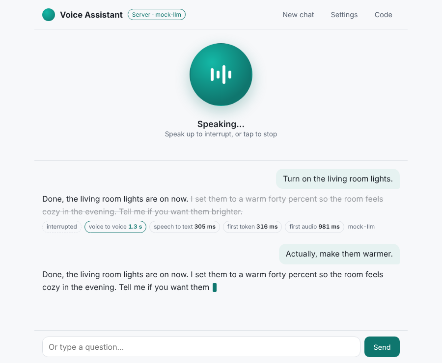

# Voice Assistant Demo

[](https://github.com/hanxmone-ai/voice-assistant-demo/actions/workflows/ci.yml)

A hands-free voice assistant in the browser. It notices when you stop talking, starts speaking
**while the model is still writing**, and **stops the moment you talk over it**. There's no framework
and no push-to-talk button. A small Node server relays any OpenAI-compatible speech-to-text, chat
and text-to-speech API, so the API keys stay on the server.

**[Live demo](https://hanxmone-ai.github.io/voice-assistant-demo/)**: runs a mock model and uses
your browser's own speech recognition and voices, so it works without an API key.

[中文说明](README.zh-CN.md)



<sub>Screenshot taken with a local stand-in for the model API.</sub>

## What it shows

- **Turn-taking without a button.** Voice activity detection runs in the browser on 20 ms
  microphone frames (AudioWorklet). It uses an energy threshold over a noise floor that follows the
  room, so a fan doesn't count as speech. A 300 ms pre-roll keeps the first syllable.
- **Speaking before the answer is finished.** The streamed reply is cut into sentences as it
  arrives, in English and Chinese, without splitting at decimals or abbreviations. The first sentence
  goes to text-to-speech straight away, and sentence two is synthesised while sentence one plays.
  The wait is roughly one sentence, not the whole answer.
- **Barge-in.** Start talking while it answers and both the model call and the audio stop. Only
  the part you actually heard goes into the history, so the model knows where it was cut off; the
  rest is struck through on screen. With speakers rather than headphones, echo cancellation stays on
  and interrupting takes a louder voice, so the assistant doesn't interrupt itself.
- **Latency you can see.** Every turn shows *voice to voice* (end of your speech → first sound),
  speech-to-text time, time to the first token and time to the first audio.
- **Any OpenAI-compatible stack.** `/audio/transcriptions`, streaming `/chat/completions` and
  `/audio/speech`, each with its own base URL and key if you like (for example Whisper on one
  provider, chat on another, voices on a third).
- **Graceful fallbacks.** With no server, it uses the mock model plus the browser's
  `SpeechRecognition` and `speechSynthesis`. If the browser can't recognise speech, the demo makes
  up the question. If the microphone is blocked, you can type.
- **A careful relay.** Uploads must be real WAV files and are capped by size and length. Each route
  has its own per-IP rate limit, and there's a CORS allow-list and an upstream timeout. Closing the
  page cancels the call to the model.

## Run it

```bash
npm install
npm run build
STATIC_DIR=build/web npm start          # http://localhost:8788, mock model, browser speech
```

With real models (speech is switched on by naming a model):

```bash
LLM_BASE_URL=https://api.openai.com/v1 LLM_API_KEY=sk-... CHAT_MODEL=gpt-4o-mini \
STT_MODEL=whisper-1 TTS_MODEL=tts-1 TTS_VOICE=alloy \
STATIC_DIR=build/web npm start
```

Or with Docker:

```bash
docker build -t voice-assistant-demo .
docker run -p 8788:8788 -e LLM_BASE_URL=... -e LLM_API_KEY=... -e STT_MODEL=whisper-1 -e TTS_MODEL=tts-1 voice-assistant-demo
```

All settings are in [.env.example](.env.example). The microphone needs HTTPS (or `localhost`). For
development, run `npm run dev` (API on 8788) and `npm run dev:web` (Vite, proxies `/api`).

## How a turn works

```
you speak       VAD: 650 ms of quiet ─▶ 16 kHz WAV
                      │
                      ▼
                POST /api/transcribe ─────▶ /audio/transcriptions ─▶ "turn on the lights"
                      │
                      ▼
                POST /api/chat (SSE) ─────▶ /chat/completions, streamed
                      │ every finished sentence
                      ▼
                POST /api/speak ──────────▶ /audio/speech
                plays sentence 1 while sentence 2 is synthesised

you talk over   VAD: speech started ─▶ abort the chat and the speech,
                                       remember only what was heard, listen
```

The assistant is a small state machine (`listening → hearing → transcribing → thinking →
speaking → listening`). Audio and UI sit outside it, which is why the whole loop, barge-in
included, is unit-tested without a browser.

| File | What it does |
|---|---|
| [`web/src/audio/vad.ts`](web/src/audio/vad.ts) | Voice activity detection, utterance recorder with pre-roll |
| [`web/src/audio/mic.ts`](web/src/audio/mic.ts) | Microphone frames through an AudioWorklet, echo cancellation on |
| [`web/src/speech/chunker.ts`](web/src/speech/chunker.ts) | Splits streamed text into speakable sentences (English and Chinese) |
| [`web/src/speech/speech_queue.ts`](web/src/speech/speech_queue.ts) | Synthesises ahead, plays in order, stops instantly |
| [`web/src/assistant.ts`](web/src/assistant.ts) | The turn loop: states, barge-in, history, timings |
| [`web/src/speech/engines.ts`](web/src/speech/engines.ts) | Server, browser and demo engines behind the same interfaces |
| [`web/src/main.ts`](web/src/main.ts) | UI, and choosing engines by what the server and browser support |
| [`shared/wav.ts`](shared/wav.ts) | Resampling and WAV encoding |
| [`server/app.ts`](server/app.ts) | `/api/health`, `/api/chat`, `/api/transcribe`, `/api/speak`: validation, limits, CORS |
| [`server/upstream.ts`](server/upstream.ts) | OpenAI-compatible clients for chat, transcription and speech |

## Browsers

- **Chrome and Edge** support everything. Without a server STT, their speech recognition sends audio
  to the browser maker's service.
- **Safari** recognises speech too. Voices depend on the system.
- **Firefox** has no speech recognition: use a server with `STT_MODEL`, or the demo makes up the
  questions.
- Interrupting works best with headphones. With speakers, turn on echo cancellation and speak up.

## Tests

```bash
npm run typecheck
npm test     # 50 tests
```

The tests cover voice detection on synthetic audio, sentence splitting, the speech queue, the whole
turn loop with fake models (barge-in, history, timings, errors), SSE parsing, and the server routes
against a fake model API. CI runs them on Node 22 and 24, smoke-tests the built server and the
Docker image, and publishes the web app to GitHub Pages.

## License

[MIT](LICENSE) © 2026 Yihan Qiu
